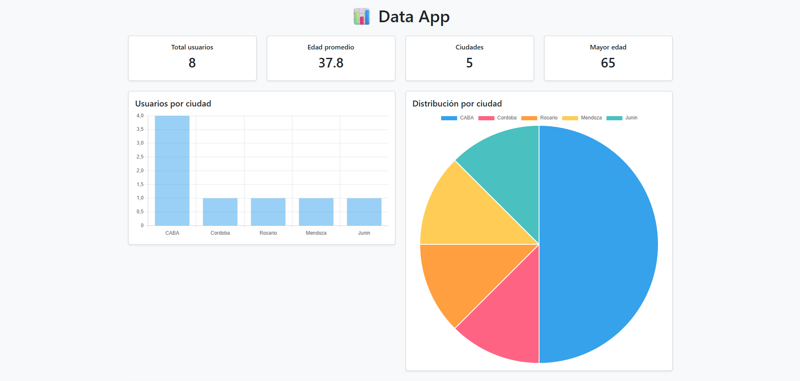
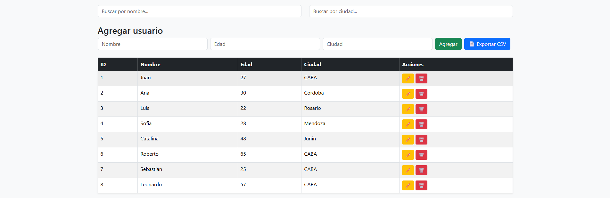
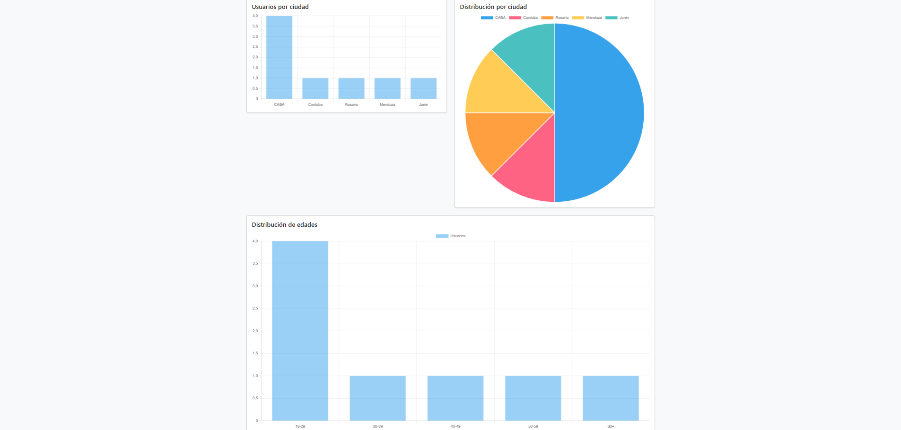
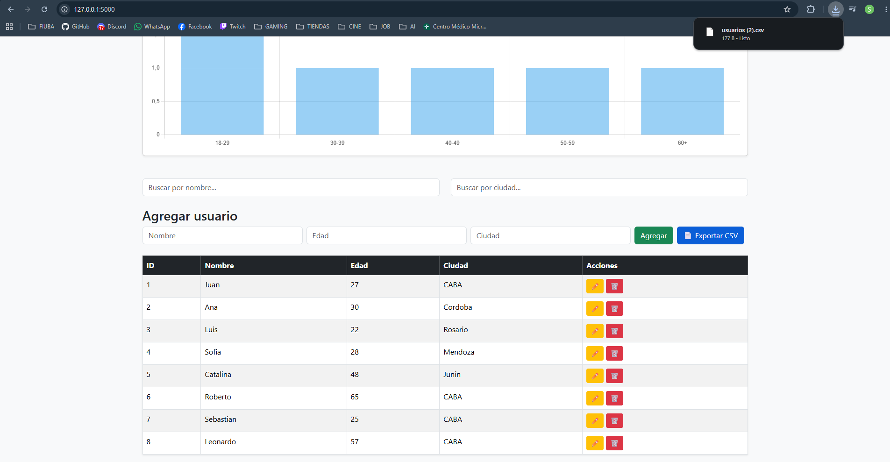

# Proyecto Data App

Aplicación web desarrollada con Python y Flask para gestionar y visualizar datos de usuarios.

**Demo online:** https://proyecto-data-app.onrender.com



## Tecnologías

- Python
- Flask
- SQLite
- SQLAlchemy
- Pandas
- OpenPyXL
- HTML
- CSS
- JavaScript
- Bootstrap
- Chart.js
- Pytest
- Docker

## Funcionalidades

### Gestión de usuarios

- Visualización de usuarios almacenados en SQLite.
- Creación de usuarios desde la interfaz.
- Edición de usuarios.
- Eliminación de usuarios.
- Validación de datos.
- Manejo de errores.

### Búsqueda y navegación

- Búsqueda por nombre.
- Búsqueda por ciudad.
- Ordenamiento ascendente y descendente por columna.
- Paginación de resultados.

### Dashboard

- Cantidad total de usuarios.
- Edad promedio.
- Cantidad de ciudades.
- Mayor edad registrada.
- Distribución de usuarios por ciudad.
- Distribución de usuarios por rango de edad.
- Gráficos interactivos.

### Exportación

- Exportación de datos a CSV.
- Exportación de datos a Excel (.xlsx).

### Interfaz

- Modo oscuro.
- Persistencia del modo oscuro mediante `localStorage`.
- Notificaciones mediante Toasts.
- Confirmación antes de eliminar usuarios.
- Interfaz responsive.

### API REST

- Endpoint `/data` para consultar los usuarios en formato JSON.
- Endpoints para crear, editar y eliminar usuarios.
- Respuestas HTTP y manejo de errores.

### Testing

- Tests automatizados con Pytest.
- Tests de endpoints de Flask.
- Tests de validaciones.
- Tests de creación, edición y eliminación.
- Tests de exportación.
- Manejo de usuarios inexistentes y solicitudes invalidas.

## Arquitectura y base de datos

La aplicación utiliza **PostgreSQL** en el entorno de producción, desplegado en Render.

También permite utilizar **SQLite** como base de datos local mediante la configuración predeterminada de `database.py`.

SQLAlchemy se utiliza para gestionar la conexión y ejecutar consultas sobre la base de datos.

## Instalación y ejecución local

Clonar el repositorio:

```bash
git clone https://github.com/Sebayur/proyecto-data-app.git
```

Entrar a la carpeta:

```bash
cd proyecto-data-app
```

Crear un entorno virtual:

## Windows

```bash
python -m venv .venv
```

Activarlo:

```bash
.venv\Scripts\activate
```

Instalar las dependencias:

```bash
pip install -r requirements.txt
```

---

## Base de datos

Si la base de datos todavía no existe:

```bash
python crear_db.py
```

## Ejecutar la aplicacion

Luego iniciar Flask:

```bash
python app.py
```

Abrir el navegador en:

```
http://127.0.0.1:5000
```

## Ejecutar los tests

Para ejecutar todos los tests:

```bash
python -m pytest -v
```

## Docker

El proyecto incluye un Dockerfile y un .dockerignore para facilitar su ejecución mediante Docker.

Una vez disponible Docker:

```bash
docker build -t proyecto-data-app .
```

Luego:

```bash
docker run -p 5000:5000 proyecto-data-app
```

La aplicacion estara disponible en:

```
http://localhost:5000
```

## Capturas

## Dashboard principal

Vista principal de la aplicación.


## Gestión de usuarios

Agregar, editar y eliminar usuarios.



## Estadísticas

Gráficos generados automáticamente.



## Exportación CSV

Exportación de la información.



## Autor

**Sebastian Yurtgulu**

Estudiante de Ingeniería Informática (FIUBA)